

# Yimo Tapir桌面宠物

**把一只戴圆眼镜的小貘，放到你的桌面。**

陪你敲键盘，等你摸摸头，也替你举一张小纸条。

**Windows x64 · Apple Silicon Mac · 四套装扮 · 可选 API 文字聊天**

### [查看 GitHub 发布页](https://github.com/mukiiiina/yimo-tapir-downloads/releases)

[版本小记](CHANGELOG.md) · [五分钟上手](#五分钟上手) · [全部玩法](#貘貘的桌面生活) · [开启聊天](#让-yimo-和你聊聊天) · [常见问题](#常见问题) · [联系创作者](#联系创作者)

**0.1.1** 改进了与 Tiny 分享零食、热可可、听心跳和投喂。换装、动作、投喂、Tiny、专注和提醒等玩法可以离线使用，接入自己的 API 后还能和 Yimo 文字聊天。

**下一版 0.1.2 正在准备。** 一轮专注结束后，Tiny 会送来休息卡，点「一起伸个懒腰」就能和 Yimo 一起活动一下。还可以到「设置 → 休息时间」调整入睡和起床时间。新版安装包的进度见[版本小记](CHANGELOG.md)。

这个仓库提供应用下载、使用说明和演示，**不开放程序源码**。作品仍会继续打磨，欢迎把遇到的问题和想要的玩法告诉我。

## 下载与安装

Windows 下载暂时下架，正在复核第三方组件和打包方式。Mac 包待构建和验证。可用版本的应用包和 `SHA256SUMS.txt` 会放在本仓库的 [GitHub Releases](https://github.com/mukiiiina/yimo-tapir-downloads/releases) 的 **Assets／附件** 里。

### Windows 第一次打开

新版 Windows x64 包发布后，可按以下步骤打开。

1. 在发布页下载 `Yimo-Desktop-Windows-x64.zip`，对照同一发布页提供的 SHA-256 校验值。
2. 解压整个 `Yimo Desktop` 文件夹，保留里面的文件，在解压后的文件夹中双击 `Yimo Desktop.exe`。第一次启动需要稍等一会，Yimo 会出现在桌面上。
3. 把鼠标移到 Yimo 身上，点击浮出的选项图标；也可以直接右键 Yimo。

签名状态以相应版本的发布说明为准。遇到安全提示时，先核对下载来源和发布页的校验值。

### Mac 第一次打开

Mac 版面向 **Apple Silicon／M 系列芯片** 和 **macOS 14.4 或更新版本**。可在苹果菜单的“关于本机”查看芯片与系统版本。通过验证后，发布页会提供安装步骤及 Apple 签名和公证状态。

## 五分钟上手

不急着接 API，也能先和貘貘玩起来。

| 想先试什么 | 这样操作 |
| --- | --- |
| 打开小面板 | 鼠标移到 Yimo 身上，点选项图标；或右键 Yimo |
| 换一身衣服 | 打开“衣柜”，选原版、太阳帽爱心镜、白大褂或冰蓝帽围巾 |
| 摸摸头 | 在头顶按住一小会，不拖动鼠标 |
| 看它小跳一下 | 双击身体 |
| 喂一点甜的 | “互动 → 投喂”，选棒棒糖或刨冰，再点一下食物，或把食物拖给 Yimo |
| 让它陪你工作 | 在“互动”打开“工作模式”；自动跟随打字可到“设置”开启 |
| 帮自己记件小事 | “互动 → 提醒小纸条”，写好内容和时间，点“交给貘貘” |
| 更多小动作 | “互动 → 更多动作”，选一个喜欢的动作 |
| 正常退出 | “设置 → 退出桌宠” |

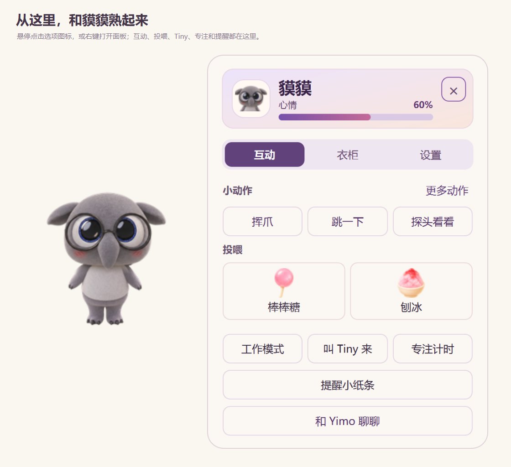

## 貘貘的桌面生活

### 01 · 今天穿哪一套？

| 装扮 | 小小的不同 |
| --- | --- |
| 原版 | 圆眼镜和软乎乎的灰色小貘，先来认识它本来的样子 |
| 太阳帽爱心镜 | 戴上黄色太阳帽和粉色爱心眼镜，还可以玩风车 |
| 白大褂 | 化身小医生，试着听听 Tiny 的心跳 |
| 冰蓝帽围巾 | 戴上针织帽与围巾，喝一杯热可可 |

在“衣柜”点击即可切换；当前装扮会保存在这台电脑，下次打开继续穿。

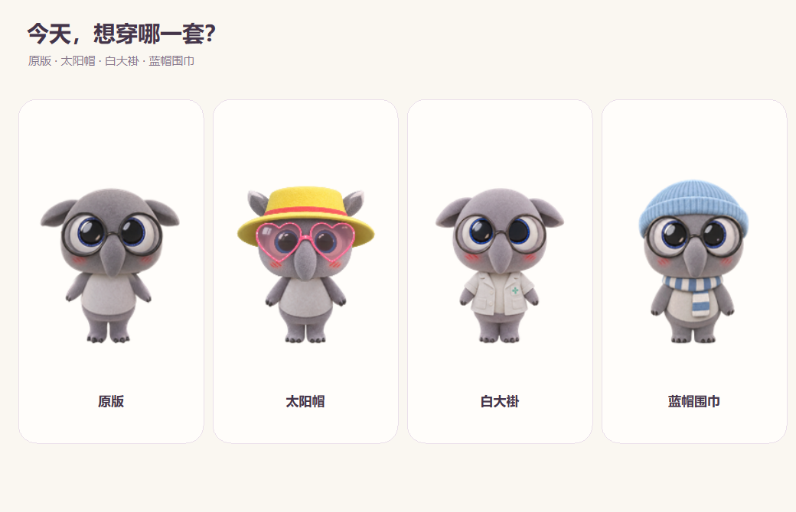

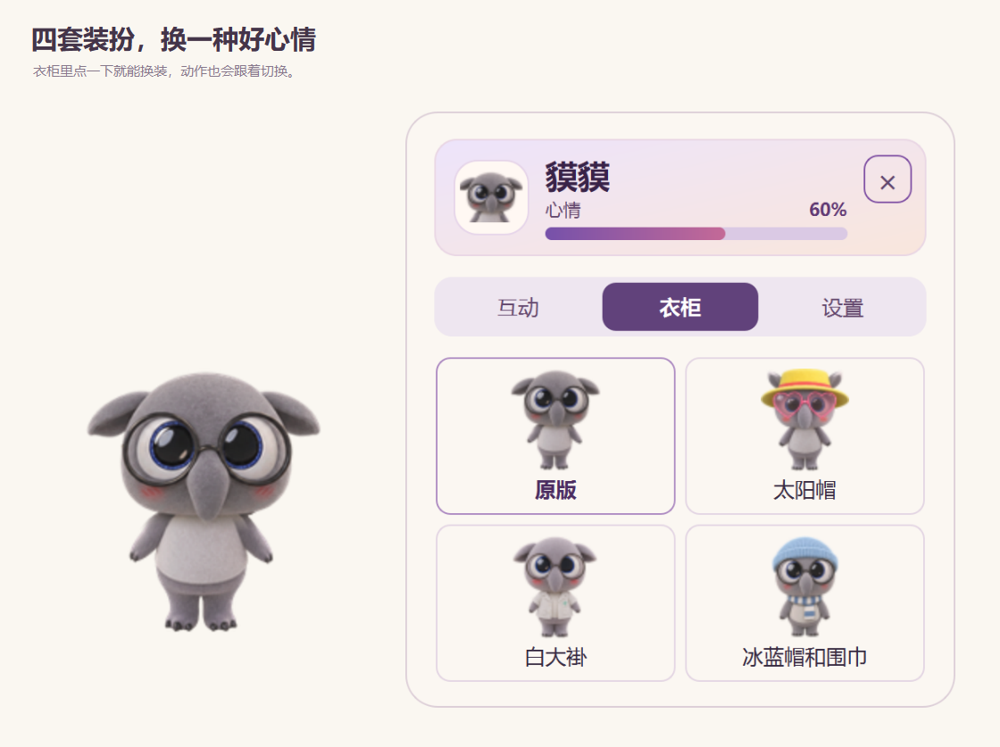

### 02 · 摸摸头、抱抱，也可以把它轻轻拎起来

Yimo 不只会站着等你点菜单。

- **轻点一下**：和它打个招呼。
- **头顶按住一会**：摸摸头，看它回应你。
- **双击身体**：小跳一下。
- **按住身体拖动**：把 Yimo 放到桌面喜欢的位置，松开后它会落稳。
- **短时间连续戳鼻尖**：它也会闹一点小脾气；别忘了再温柔地哄哄它。

想让它安静待在一角，可以打开“设置 → 锁定位置”。锁住后仍能轻点和双击，拖动与自由移动会暂停。

“互动 → 更多动作”里还有抱抱、伸懒腰、探头、抖一抖、做鬼脸、偷瞄和跺脚等动作。不同装扮的动作名称和小剧情会略有区别，以面板里显示的按钮为准。

### 03 · 你敲键盘，它也认真上班

在“互动”打开 **工作模式**，Yimo 会坐到小电脑前陪着你。

如果想让它自己跟上你的节奏，打开 **设置 → 打字时自动陪伴**：开始打字时坐下，停下后收爪、收好电脑，再回到休息状态。

Mac 的自动打字陪伴默认关闭。主动开启时，可能需要到“系统设置 → 隐私与安全性 → 输入监控”允许 Yimo；面板里也有“打开输入监控设置”入口。按系统提示重新打开应用后再试。不授予此权限，仍可玩换装、动作、投喂、Tiny、提醒和文字聊天。

打字陪伴使用按键发生的时间来驱动动作，**不保存你具体输入的文字**。

### 04 · 来一颗棒棒糖，还是一碗刨冰？

打开 **互动 → 投喂**，选择零食。食物出现后，可以点一下，也可以拖到 Yimo 身边。

**棒棒糖**：先开心地立耳，接到小爪里，再转一转、舔两口。

**刨冰**：认真托住碗，拿起小勺舀着吃；冰到时还会轻轻抖一下，最后收好、回味。

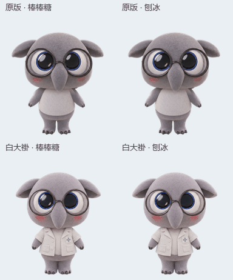

[观看 0.1.1 的八组投喂演示](media/feeding-0.1.1.mp4)

### 05 · Tiny 来了，不是只有一只貘貘陪你

点 **互动 → 叫 Tiny 来**，让小鸟飞到旁边。想让它回去时，再点“让 Tiny 回去”。

在“更多动作”试试 **和小鸟分零食**。Tiny 会凑近啄食，Yimo 拿稳零食并回应。白大褂的 **听听小鸟的心跳** 还有听诊与小鸟的回应。

睡觉时，Tiny 也可能飞来照顾貘貘的小被子。有些小剧情需要两位都闲下来，正在打字、拖动或切换动作时，会先把眼前的事做完。

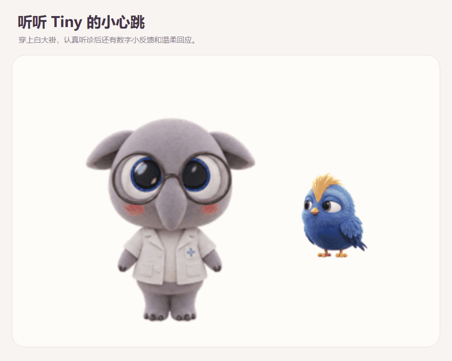

### 06 · 小风车、热可可和一点好运气

换套装扮，再到“互动 → 更多动作”看看：

| 想玩什么 | 去哪里找 | 可以怎么回应 |
| --- | --- | --- |
| 风车 | 太阳帽装扮 →“追风车” | 风车拿出来后点一点击，它会转起来；停留期间还能继续点 |
| 小医生 | 白大褂装扮 →“听听小鸟的心跳” | 看它给 Tiny 听诊，留意画面里的心跳数值和回应 |
| 热可可 | 冰蓝帽围巾 →“喝杯热可可” | 陪它安静喝一点热的 |
| 吸走坏运气 | “互动 → 更多动作 → 吸走坏运气” | 看见小小的好运圈后，点它或拖给貘貘 |

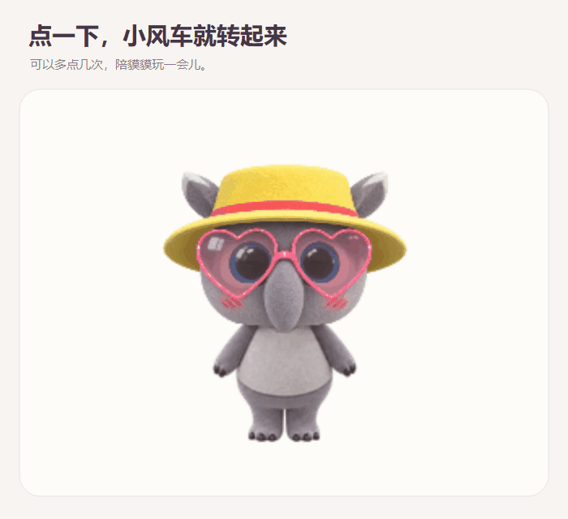

### 07 · 弹首小曲，坐一会儿

在“更多动作”点 **弹吉他**，它会坐下来弹一小段。

想听轻柔配乐，打开 **设置 → 互动声音 → 手动弹琴时播放轻柔配乐**，并调整音量。配乐在手动点“弹吉他”时播放；自主活动或聊天触发的动作不会突然自行出声。音量调为 0 可以立即静音。

### 08 · 散散步，也允许什么都不做

在“设置”打开 **自主活动**，Yimo 会穿插呼吸、眨眼、散步、打盹和其他小动作。

再开启 **在屏幕上自由活动**，它可以走远一点，偶尔还有小翅膀的惊喜。需要固定它的位置时，打开“锁定位置”即可。

想让它好好休息，可以点 **更多动作 → 盖被子睡觉**；只是短短眯一会，则选“闭眼打个盹”。睡着后轻点 Yimo，就能叫醒它。开启自主活动后，它也可能在安静的时候自己休息。

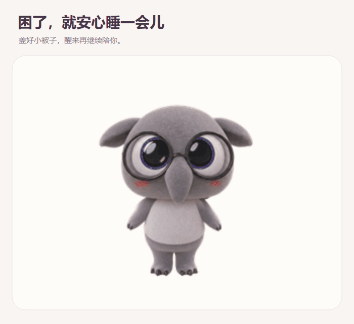

### 09 · 一起专注 25 分钟

打开 **互动 → 专注计时**，开始一轮 **25 分钟专注 + 5 分钟休息**。

面板会显示当前阶段与倒计时。中途可以“暂停”，准备好了点“继续”；不需要这一轮时点“结束”。休息结束后本轮完成，需要时再开始下一轮。

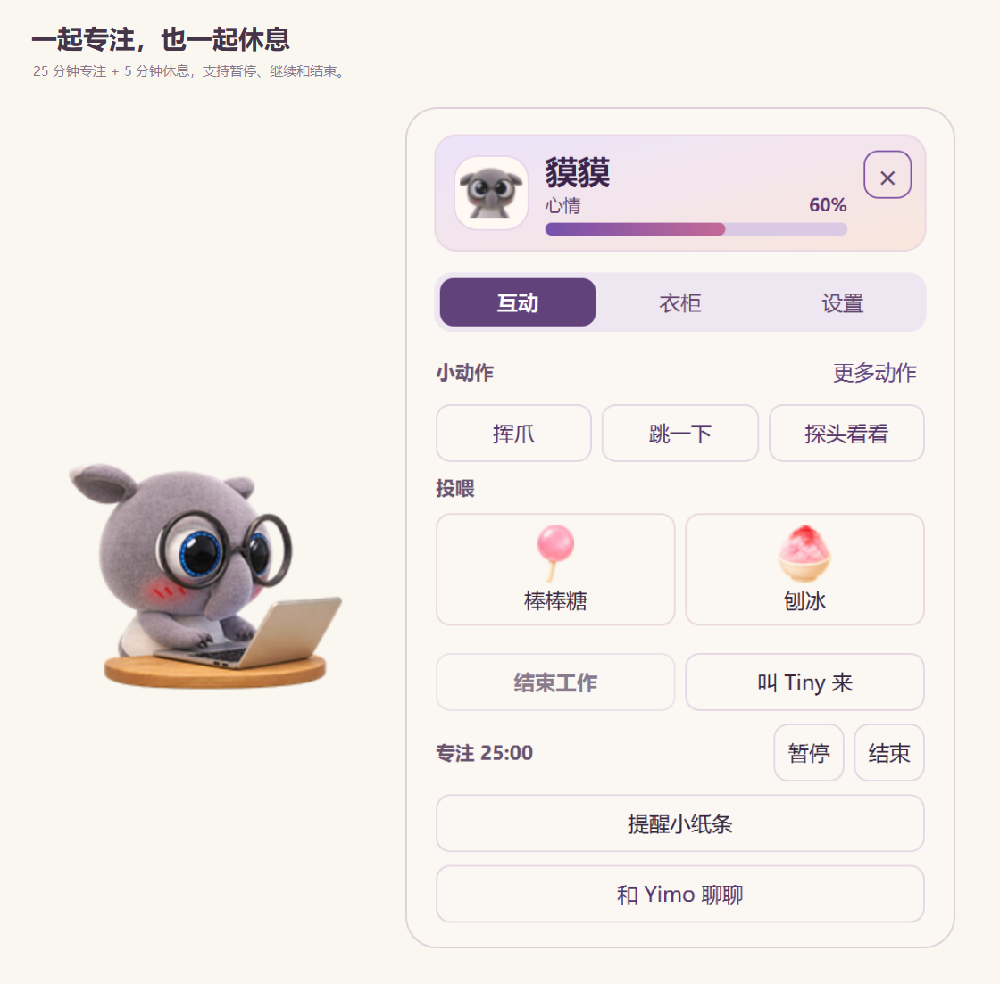

### 10 · 重要的小事，让它举牌告诉你

打开 **互动 → 提醒小纸条**：

1. 写下想提醒自己的话，比如“起来喝口水”或“该准备出门啦”。
2. 点击日期选择日历，再分别选择小时和分钟。
3. 赶时间的话，可以直接点 **5 / 15 / 30 分钟后、1 小时后**。
4. 先点“预览纸条”看效果；满意后点 **交给貘貘**，才会正式保存提醒。

到点时，Yimo 会双爪抱起小纸条；点 **收到**，它会点头收好。

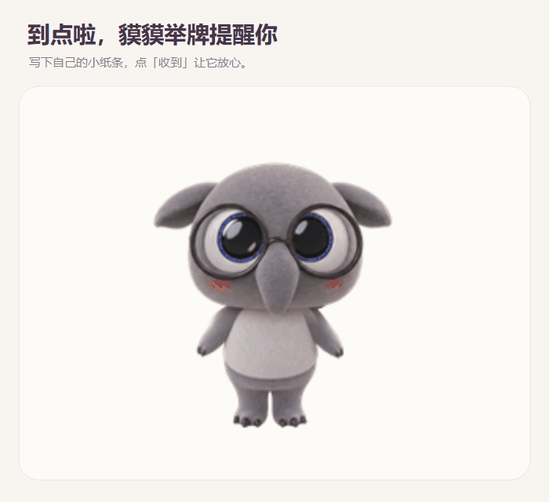

已经交付的纸条会在本机保存。关闭窗口和预览返回会保留草稿；“待提醒的纸条”中可以选中不需要的项目，再点“移除选中”。

提醒需要 Yimo 在运行。退出程序或电脑休眠时，不能保证准点出现；未确认的已保存提醒会在下次打开后继续处理。

## 让 Yimo 和你聊聊天

这是可选的 **文字聊天**。不接 API，也能使用前面的桌宠玩法。

聊天窗口浮在 Yimo 身旁，回复从头边的小气泡冒出来。它也会根据对话做出害羞、安慰、庆祝等反应。想让它直接行动，可以试试：

> 抱抱我。　挥挥手。　摸摸头。　跳一下。

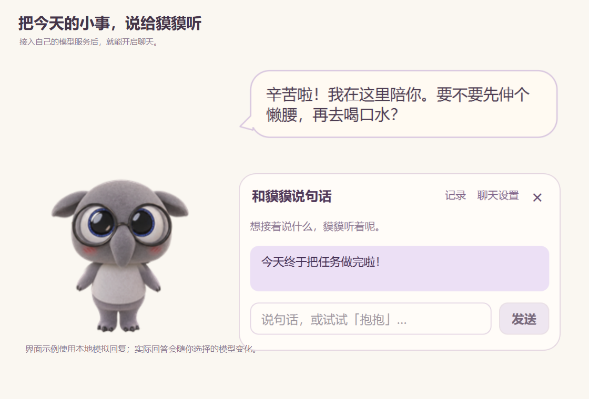

*聊天图片为界面示例，使用本地模拟回复展示排版；真实回复内容、速度和可用性取决于你选择的模型与网络。*

### 三步接入自己的 API

**1．打开连接页**

在“互动”点“和 Yimo 聊聊”；首次未配置时会进入连接设置。也可以直接打开 **设置 → AI 聊天连接 · 选择服务商**。

**2．选服务商，填自己的 Key**

点击服务商卡片，应用会填入预设接口地址和模型。在专门的 **API Key** 输入框粘贴你自己的 Key；模型名称可以修改。

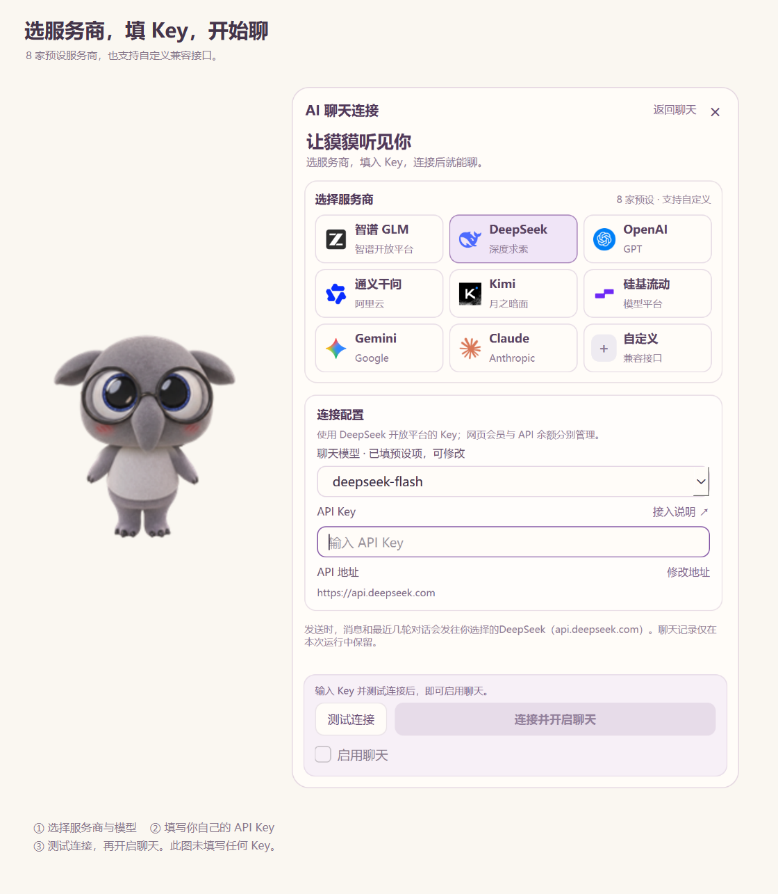

可以选择以下平台，也可以自行填写兼容接口：

| 服务商 | 接入时留意 |
| --- | --- |
| 智谱 GLM | 使用开放平台的通用 API Key，编程套餐专用 Key 不要混用 |
| DeepSeek | 使用开放平台 Key，API 余额与网页服务分别管理 |
| OpenAI | 使用 API 平台 Key，ChatGPT 订阅与 API 额度分别管理 |
| 通义千问 | 使用阿里云百炼 Key，Key 与接口地域要对应 |
| Kimi | 使用开放平台通用 API Key，Kimi Code 专用 Key 不适用 |
| 硅基流动 | 使用对应平台 Key，模型名要与该平台一致 |
| Google Gemini | 使用 Gemini API Key，确认账号、模型和网络可用 |
| Anthropic Claude | 使用 Claude API Key，应用会使用相应的官方接口格式 |
| 其他 · 自定义兼容接口 | 填入提供方给你的 OpenAI 兼容地址、模型名和 Key |

每张预设卡片都有“接入说明 ↗”，可打开对应服务商文档。预设模型可能随服务商调整；遇到不可用的模型，请换成自己账号有权限的模型。**API 的额度、地区限制和费用由所选服务商决定，桌宠不附送共享 Key。**

需要修改接口地址时，点 **修改地址**。自定义连接会让你填写地址和模型；请仅使用你信任的接口，并按提供方说明填写。

**3．连接并开始聊天**

点 **连接并开启聊天**；也可以先“测试连接”，验证成功后点“开始聊天”。开启后，悬停 Yimo 身上还会出现聊天入口。

发送消息后，刚刚发出的内容会留在短框里。点 **记录** 直接展开本次运行的完整会话，上下滚动查看；再点“收起”恢复短框。连接失败时可以查看提示并重试，聊天设置里也可关闭聊天或“移除 Key”。

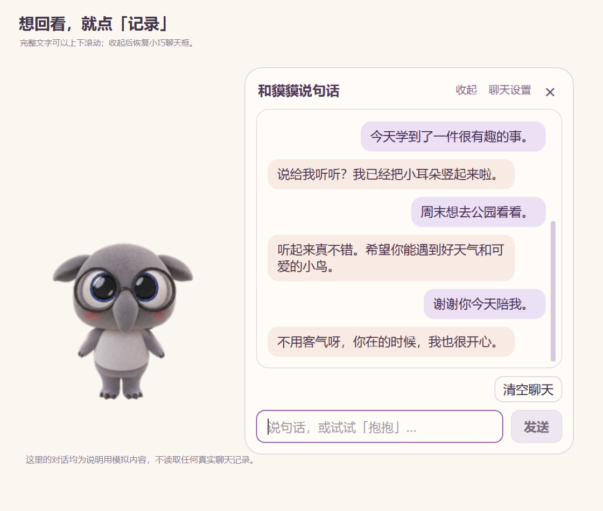

### 关于聊天与隐私

- Key 保存在你这台电脑的 **Windows 凭据管理器 / Mac 钥匙串**；发送请求时，用于访问你选定的 API 地址。换服务商或接口后，需要重新测试连接。
- 发送消息时，当前内容及必要的近期对话会交给你选定的 API 服务商处理；不要发送自己不愿分享给该服务商的信息。
- 聊天记录只保留在 **本次运行** 中，退出桌宠后不会恢复上一段对话。
- 只把 Key 填在专用输入框里，不要当成消息发给 Yimo，也不要放进反馈截图。
- 本初版为文字聊天，没有语音通话或麦克风聊天功能。

## 把陪伴调成自己喜欢的样子

在 **设置** 里可以调整：

| 选项 | 作用 |
| --- | --- |
| 桌宠大小 | 80% / 100% / 125%，选择适合屏幕的一档 |
| 自主活动 | 闲下来时自己穿插动作 |
| 打字时自动陪伴 | 跟随你的打字节奏坐到电脑前 |
| 在屏幕上自由活动 | 允许在屏幕上走远一点 |
| 锁定位置 | 暂停拖动和自由移动，保留轻点、双击等互动 |
| 互动声音与音量 | 控制手动弹吉他的配乐 |
| AI 聊天连接 | 选择服务商、管理 Key、测试连接 |
| 版本与更新 | 查看当前版本、检查新版和打开下载页面 |
| 联系创作者 | 展开主页、邮箱和反馈说明 |
| 退出桌宠 | 正常关闭应用并保留本机偏好 |

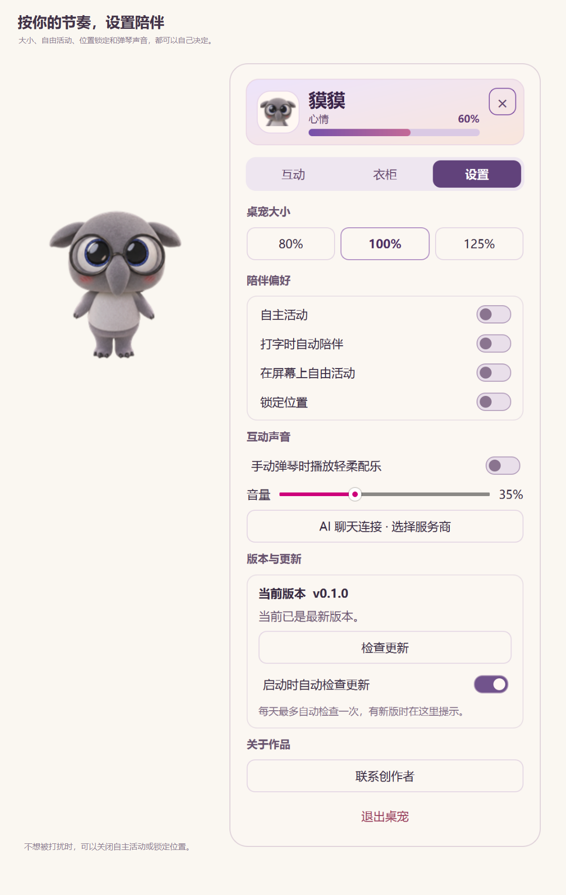

### 后面怎么更新？

在 **设置 → 版本与更新** 点“检查更新”。发现新版时，使用“下载最新版”打开对应附件。也可以开启按天自动检查，发现更新后再自行决定是否下载。

下载完成后，先退出旧版，再按发布页说明打开新版。Windows 压缩包请解压到新的完整目录，直接从该目录运行。原有装扮、位置、偏好、提醒和系统凭据继续存放在本机。更新由你在发布页下载并手动安装。

只想手动更新，也可以收藏 [公开发布页](https://github.com/mukiiiina/yimo-tapir-downloads/releases)。

## 常见问题

<strong>不接 API 能玩吗？是不是每个动作都要联网？</strong>

可以。换装、摸头、拖动、动作、投喂、Tiny、打字陪伴、专注和提醒都能在本机使用。只有你启用的 API 聊天需要连接所选服务商；检查更新也需要网络。

<strong>双击没反应，或找不到 Yimo 了怎么办？</strong>

初次启动先等几秒。当前只会保留一个正常运行的实例，重复打开不一定再出现第二只。尝试切换到桌面，看看是否在其他显示器或原来的位置；正常退出后再打开，也会尝试把它放回可见区域。

如果仍没有出现，请附上系统版本、下载的文件名和截图反馈，不需要安装 Python 或重新下载“源码压缩包”。

<strong>为什么不能拖动，或者没有自己到处走？</strong>

先看看“设置 → 锁定位置”是否开启。自由活动需要相应开关开启，也会给正在进行的工作、睡觉和互动让路，不会每次开关后立刻走起来。

<strong>为什么没听到吉他配乐？</strong>

检查“手动弹琴时播放轻柔配乐”与音量，再到“更多动作”手动点“弹吉他”。聊天触发或自主活动中的弹琴不会自己出声；还可以检查电脑的应用音量与静音状态。

<strong>自动陪我打字没有触发？</strong>

确认开启了“打字时自动陪伴”，先让 Yimo 从当前动作结束，再试着输入一小段文字。Mac 还要检查“输入监控”权限，并按系统要求重开应用。手动的“工作模式”和自动跟随是两个入口，可以先试前者。

<strong>API 测试失败、模型不可用，或一直没有回复？</strong>

依次核对服务商、Key、账号额度、模型权限和接口地址；地域型服务要确认 Key 与接口地域一致。网页会员、编程套餐与通用 API 可能使用不同凭据。可用“接入说明 ↗”查看服务商文档，再回到应用测试。

反馈时请提供服务商名称、模型、错误提示和复现步骤，**不要发送完整 Key**。不要为了排查把密钥贴在公开 Issue 中。

<strong>提醒在电脑休眠或退出桌宠后，还会准点出现吗？</strong>

不能保证。它是随桌宠运行的本地小纸条，需要程序运行和电脑处于可工作的状态。已保存、未确认的提醒会在再次打开后继续处理。重要事项也请同时使用你常用的日历或系统提醒。

<strong>Mac 上能在其他应用全屏时陪着我吗？</strong>

应用已做普通桌面和原生全屏空间的悬浮适配。不同软件的排他全屏、台前调度与多屏切换仍可能有差异；若遇到遮挡，欢迎附上 macOS 版本、全屏应用名称和操作步骤反馈。

<strong>可以隐藏或退出吗？会不会丢设置？</strong>

在“设置”点“退出桌宠”即可。装扮、位置和偏好保存在本机；已交付的提醒会保留，聊天内容不会跨运行保存。如果不想继续保留 API Key，可在退出前到聊天连接页点“移除 Key”。

## 认识原本的 Yimo

**角色 IP：Yimo Tapir。** 感谢原作者带来的这只温柔又有点调皮的小貘。本项目是桌面陪伴同人作品，桌宠创作者主页与角色官方账号分别列在这里。

| 去看看 Yimo | 主页 |
| --- | --- |
| YouTube | [YIMO the Tapir](https://www.youtube.com/@YIMOtheTapir) |
| TikTok | [@yimotapir](https://www.tiktok.com/@yimotapir) |
| Instagram | [@yimo_tapir](https://www.instagram.com/yimo_tapir/) |

应用使用的第三方组件许可可查看 [许可说明](licenses/THIRD_PARTY_NOTICES.txt)。

## 联系创作者

**桌宠创作者　[@芝士奶盖猪](https://xhslink.cn/o/9SKK92mZzbX)**

📮 **[mitreeing@gmail.com](mailto:mitreeing@gmail.com)**

感谢大家的支持！

如果你有更多优化 Yimo 桌面宠物的建议，或者发现了 bug，欢迎发送到我的邮箱。也可以在本仓库的 [Issues](https://github.com/mukiiiina/yimo-tapir-downloads/issues) 留言。

反馈时带上 **应用版本、系统与芯片型号、当前装扮、操作步骤、截图或短视频**，会更容易找到问题。发之前记得遮住自己的 Key 和私密聊天。

愿貘貘在你的桌面上，陪你把今天过得轻一点。
